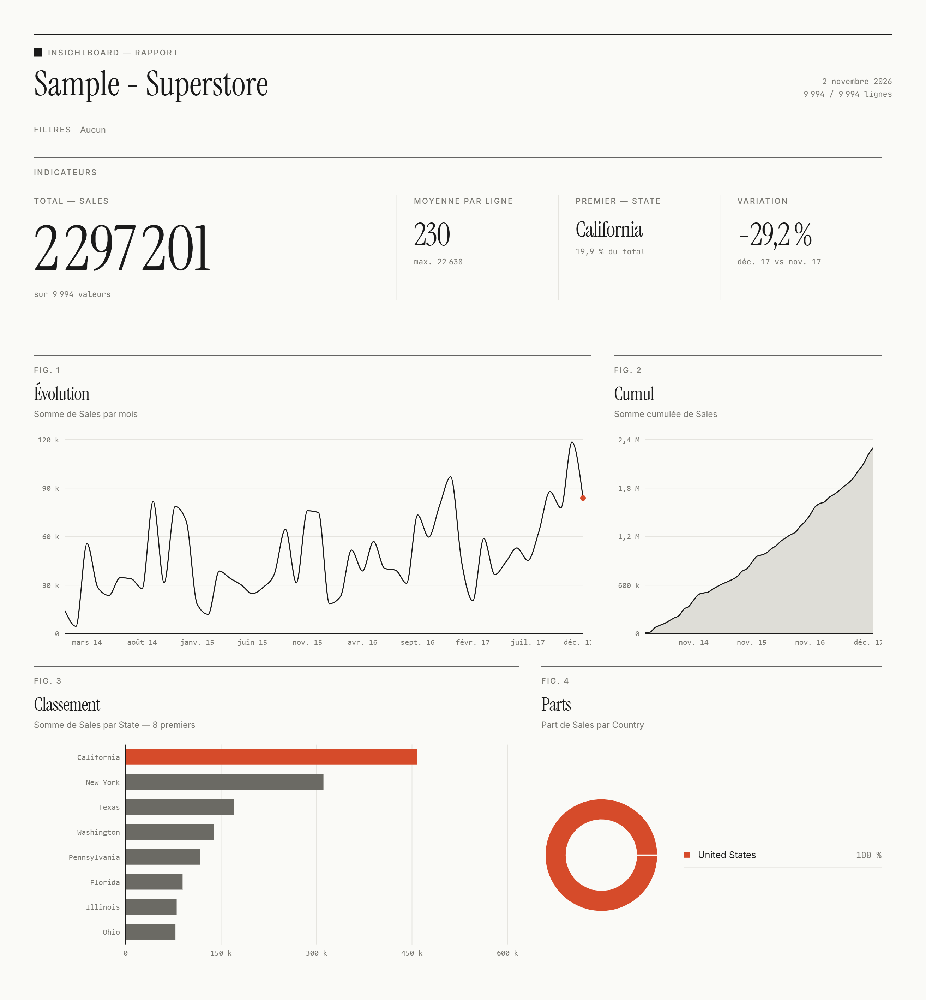
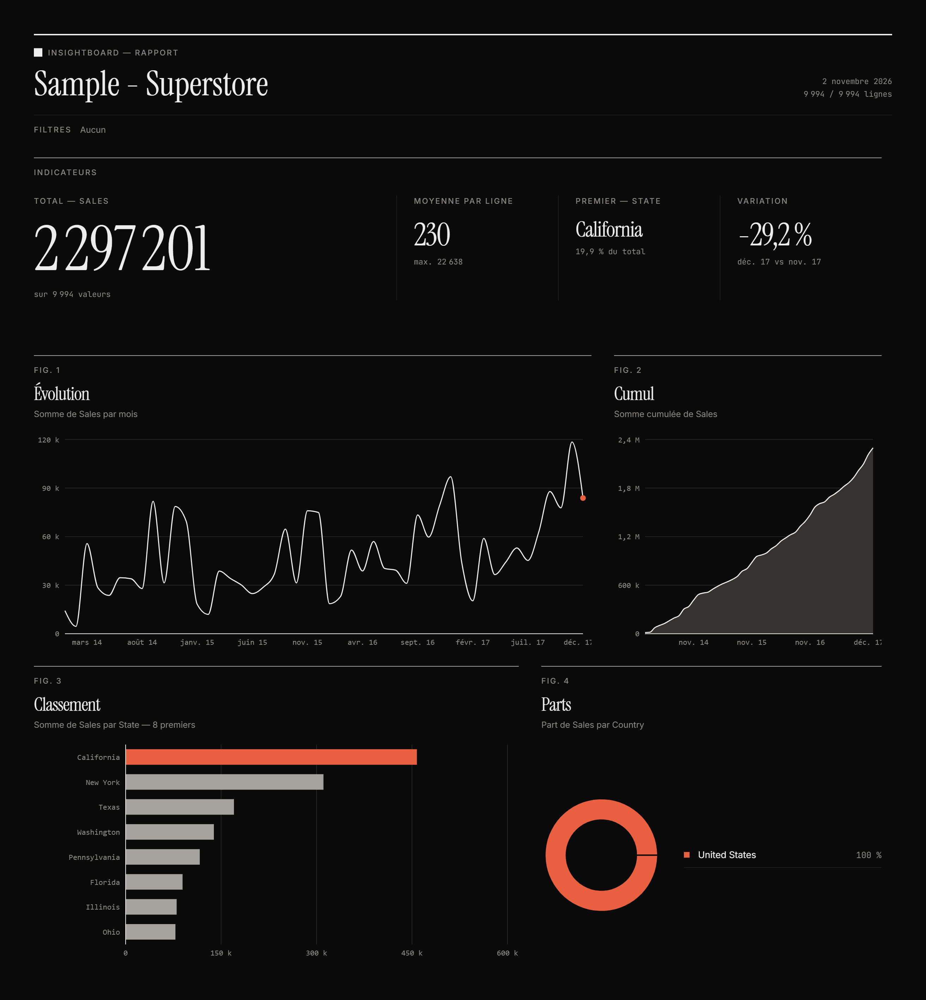
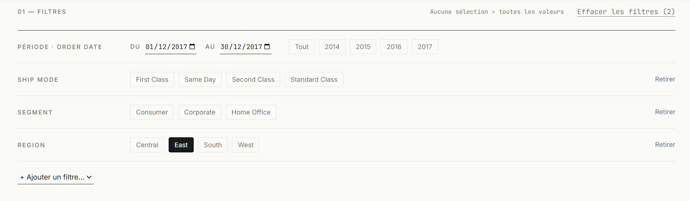
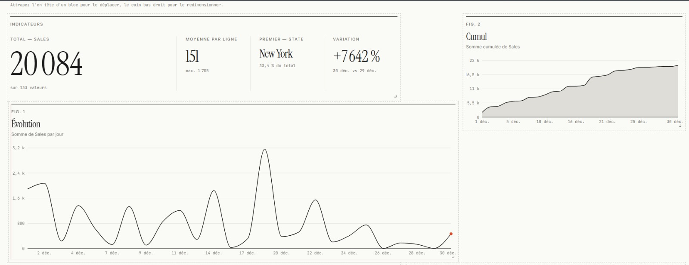

# InsightBoard

Un tableau de bord interactif qui tourne entièrement dans le navigateur. On dépose un fichier CSV ou Excel, et les indicateurs, les graphiques et les filtres se construisent à partir de ses colonnes.

**Démo :** [insight-board-iitsh.vercel.app](https://insight-board-iitsh.vercel.app/)



## Contexte

Des outils comme Power BI font bien leur travail, mais ils imposent leur environnement. Je voulais savoir ce qu'il faut réellement construire pour reproduire l'essentiel dans une application React : importer un fichier, choisir une mesure, filtrer, organiser la page, exporter le résultat.

InsightBoard est ma réponse. Il n'y a ni serveur, ni compte, ni base de données.

## Objectif

Rendre un fichier exploitable sans configuration préalable. Les colonnes sont analysées à l'import, des réglages par défaut sont proposés, et chacun reste modifiable.

## Fonctionnalités

- **Import CSV et Excel.** Les données restent dans le navigateur. Rien n'est envoyé.
- **Détection des colonnes.** Chaque colonne est typée (nombre, date, catégorie) et une mesure, un classement, une répartition et une date sont choisis par défaut.
- **Cinq blocs de lecture.** Indicateurs clés, évolution dans le temps, cumul, classement et répartition.
- **Somme ou moyenne.** La moyenne est choisie d'office pour les colonnes qui décrivent un taux, une remise ou une note. Le choix manuel est toujours prioritaire.
- **Filtres par catégorie et par période.** Tous les calculs et graphiques se mettent à jour.
- **Mise en page libre.** Les blocs se déplacent et se redimensionnent. La disposition est conservée d'une visite à l'autre.
- **Export PNG et PDF.** Le rapport exporté porte un en-tête : fichier, date, nombre de lignes et filtres actifs.
- **Thème clair et sombre.**
- **Tableau de données.** Il reflète les filtres en cours.

| Mode sombre | Filtres actifs |
|---|---|
|  |  |



## Technologies

| Rôle | Outil |
|---|---|
| Interface | React, Vite |
| Style | Tailwind CSS v4 |
| État | Zustand |
| Graphiques | Recharts |
| Grille déplaçable | react-grid-layout 1.5 |
| Lecture des fichiers | PapaParse (CSV), SheetJS (Excel) |
| Export | html2canvas-pro, jsPDF |

## Choix de conception

- **Pas de backend.** Le fichier ne quitte jamais l'ordinateur de l'utilisateur. C'est aussi ce qui permet un déploiement statique.
- **Les filtres lisent les données complètes, les calculs lisent les données filtrées.** Sinon, les autres valeurs disparaîtraient de la liste dès qu'on en sélectionne une.
- **`html2canvas-pro` plutôt que `html2canvas`.** Tailwind v4 génère des couleurs en `oklch()` et `color-mix()`, que `html2canvas` ne sait pas lire.
- **`react-grid-layout` en version 1.5.** C'est la version qui fonctionne avec React 19 dans ce projet.
- **Direction visuelle.** Des filets plutôt que des cartes, trois polices (Instrument Serif, Inter, JetBrains Mono) et un seul accent orange, réservé à l'état actif et à l'élément clé de chaque graphique.

## Lancer le projet

Node 20 ou plus récent.

```bash
git clone https://github.com/iitsh/InsightBoard.git
cd InsightBoard
npm install
npm run dev
```

Pour produire la version de déploiement : `npm run build`.

## Structure

```
src/
├── components/   interface, blocs du dashboard, filtres, export
│   └── charts/   les quatre graphiques
├── store/        données, thème, disposition (Zustand)
└── utils/        lecture de fichiers, profil des colonnes,
                  agrégations, filtres, export
```

## Limites connues

- L'affichage est pensé pour les écrans de 1024 px et plus. Le mobile n'est pas encore adapté.
- Le PDF est une image : son contenu n'est ni sélectionnable ni copiable.
- Pour les dates, si le premier nombre dépasse 12, il est lu comme un jour. Sinon, le format américain (mois/jour/année) est retenu.
- Le graphique de parts n'a pas de sens avec des valeurs négatives (une colonne de profit, par exemple).
- Les colonnes qui contiennent plus de 50 valeurs distinctes (noms de clients, de produits) ne sont pas proposées comme filtres.
- En mode moyenne, le classement favorise les petits groupes.

## Pistes

- Recherche textuelle dans les filtres à nombreuses valeurs.
- Export CSV des données filtrées.
- Seuil minimal de lignes par groupe dans les classements en moyenne.

## Auteur

Rayane Berrada, [github.com/iitsh](https://github.com/iitsh)
